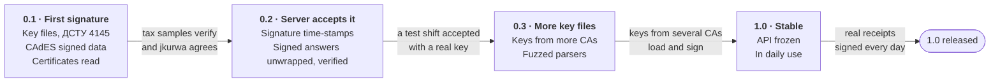

# uakep: Ukrainian КЕП signatures in pure Python

## What this is

uakep is a pure-Python library for Ukrainian qualified electronic signatures (КЕП) on ДСТУ 4145-2002, ported from [jkurwa](https://github.com/dstucrypt/jkurwa). Its first job is to sign documents for the State Tax Service's fiscal server (ПРРО) in the exact format that server accepts, using the key files sellers already have.

No native binaries, no Java, no Node: the goal is `pip install` and sign.

**Українською.** uakep — бібліотека на чистому Python для кваліфікованого електронного підпису за ДСТУ 4145-2002, порт бібліотеки jkurwa. Вона читатиме ключі (Key-6.dat, .jks, .pfx) і підписуватиме документи у форматі CAdES з позначкою часу, як цього вимагає фіскальний сервер ДПС для програмних РРО.

## Status

Pre-alpha: there is no code to install yet, and this README is the plan. The first milestone is a document signed by uakep and accepted by the tax service's fiscal server in its test mode (see [Roadmap](#roadmap)).

## Why it exists

Python has no open-source library that signs the way the fiscal server requires. The tax service publishes the protocol, XSD schemas and examples, but no client library in any language ([official description](https://tax.gov.ua/baneryi/programni-rro/opis-ari-fiskalnogo-servera/opis-ari--kontrolyuyuchogo-organu/), [Markdown mirror](https://github.com/VSydorenko/prro_docs)). Sending a document is a plain HTTP POST; signing it is the hard part.

| Library | Language | Source | Notes |
| --- | --- | --- | --- |
| [IIT signing library](https://iit.com.ua/downloads) | C, with a Python interface | Closed, native binary | Its downloads page publishes no license terms |
| [jkurwa](https://github.com/dstucrypt/jkurwa) | JavaScript | Open, BSD | Maintained since 2014; reads Key-6.dat, .jks and .pfx; adds signature time-stamps |
| [ppolib](https://github.com/leon-mbs/ppolib) | PHP | Open, MIT | Port of jkurwa, written for a CRM's ПРРО |
| [uacrypto](https://github.com/h0rn3t/uacrypto) | Go | Open | First published in November 2026 |

A Python service today needs a native binary or a second runtime beside it. uakep removes both.

## First release: scope and non-goals

The first release does what the fiscal server needs and nothing more. The server's rules are in its [API description](https://github.com/VSydorenko/prro_docs), section «Порядок засвідчення повідомлень».

- **Keys:** read the private key from IIT Key-6.dat, PrivatBank .jks and PKCS#12 .pfx files, given the password.
- **Signature:** sign and verify with ДСТУ 4145-2002 on binary-field curves, named or given in the certificate, with the ГОСТ 34.311-95 hash (ДСТУ 7564 «Купина» where a certificate needs it).
- **Container:** build CAdES-E-T signed data with the document attached and the signer's certificate inside, and without issuer certificates, CRLs or OCSP answers.
- **Time-stamp:** add a signature time-stamp (RFC 3161) from the server named in the signer's certificate for online documents, and none for offline ones; never a content time-stamp, which the fiscal server refuses.
- **Certificates:** read owner name, РНОКПП or ЄДРПОУ, validity and key usage.
- **Answers:** unwrap the fiscal server's signed answers and verify its signature.

Not in the first release: encryption (EnvelopedData), XAdES, PAdES and ASiC, cloud signatures such as Дія.Підпис, hardware tokens, certificate lookup over CMP, OCSP and CRL checks, and a ПРРО client (receipt XML, shifts, offline mode).

## Planned API

A sketch of the intended use; names and arguments may change before 0.1.

```python
from uakep import load_key, sign, unwrap

# Key-6.dat holds no certificate, so pass the .cer file; .jks and .pfx carry their own
key = load_key("Key-6.dat", password="…", certificate="signer.cer")

# CAdES-E-T: document attached, signer's certificate inside,
# signature time-stamp from the server named in that certificate
signed = sign(receipt_xml, key, timestamp=True)

# POST `signed` to https://fs.tax.gov.ua:8643/fs/doc as application/octet-stream
ticket_xml = unwrap(response_body)  # checks the fiscal server's signature
```

## How correctness is proven

Every layer is checked against ground truth that uakep did not produce, from the curve arithmetic up to the live fiscal server.

| Check | What it proves | Ground truth |
| --- | --- | --- |
| Standard test vectors | Field and curve arithmetic, ДСТУ 4145 signatures, ГОСТ 34.311 and Купина hashes, ГОСТ 28147 match the standards | Worked examples in each standard |
| jkurwa's test data | Key files decrypt to the right keys; real certificates parse; real CAdES-C, -T and -X signatures verify | [jkurwa test/data](https://github.com/dstucrypt/jkurwa/tree/master/test/data): key stores, certificates, .p7s files |
| The tax service's signed samples | A signed receipt, Z-report and command, as the fiscal server sees them, verify and unwrap | «Приклади з КЕП» published with the [API description](https://github.com/VSydorenko/prro_docs) |
| Differential tests | Every signature uakep makes verifies in jkurwa, and every jkurwa signature verifies in uakep, over thousands of random keys and documents | jkurwa, run in CI |
| Fuzzing | Malformed key files, certificates and server answers raise clean errors, never crash or hang | Property-based and fuzz tests |
| Fiscal server, test mode | A whole shift (open, sale, Z-report, close) is accepted with a real key; test documents carry no tax effect | `<TESTING>true</TESTING>` documents on the live server |
| Real use | Keys from many CAs and real receipts, every day | Production users |

The first five run on every commit. The test-mode shift runs before each release, with a maintainer's own key.

## Roadmap



Each arrow is the gate that ends a phase. 1.0 waits for real receipts, because tests cannot cover every CA's key files.

## Security and legal notes

- **Keys stay with the caller.** uakep never writes a key or password to disk or logs, and never sends either over the network.
- **Timing.** Python integers are not constant-time. uakep keeps jkurwa's countermeasure, a signing scalar of fixed bit length, and is meant for a server signing its own documents, not for hardware an attacker can measure.
- **Not a certified signature tool.** uakep has no expert conclusion from Держспецзв'язку. Nothing in the fiscal server's protocol names the software that made a signature, but whether your use needs certified software is a question for your lawyer.
- **Reporting a vulnerability.** Use GitHub's private vulnerability reporting on this repository, not a public issue.

## Credits, license and contributing

- **Credits.** The cryptography is ported from [jkurwa](https://github.com/dstucrypt/jkurwa) by Ilya Petrov. [ppolib](https://github.com/leon-mbs/ppolib) by leon-mbs is a second reference. The protocol notes come from the tax service's [published description](https://tax.gov.ua/baneryi/programni-rro/opis-ari-fiskalnogo-servera/opis-ari--kontrolyuyuchogo-organu/), mirrored as Markdown in [VSydorenko/prro_docs](https://github.com/VSydorenko/prro_docs).
- **License.** MIT for uakep's own code. Ported parts keep jkurwa's copyright notice and BSD terms, collected in NOTICE.
- **Open question.** jkurwa's repository has no LICENSE file, only "BSD" in its package.json; before 0.1 we ask its author which BSD text applies.
- **Contributing.** The most useful help is test data: a document signed with a key from a CA not yet covered, or one the fiscal server rejected, with its error. Never send a private key or its password. A signed document carries your certificate, so share only what you are fine making public.
